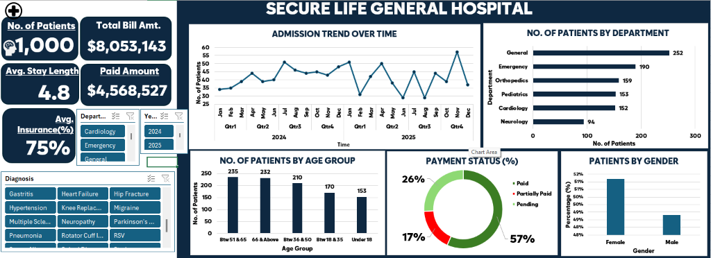
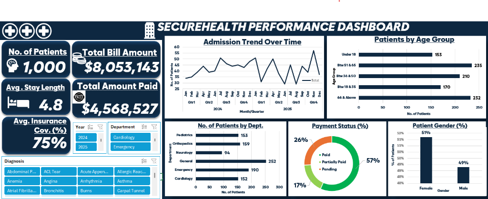

# 🏥 SECURE HEALTH GENERAL HOSPITAL PERFORMANCE DASHBOARD
### *Executive Operational Efficiency, Clinical Throughput & Financial Revenue Analytics*


[](https://products.office.com/excel)
[](https://github.com/BimelsHabtamu/Data-Analysis-Project)
[](https://github.com/BimelsHabtamu/Data-Analysis-Project)
[](https://opensource.org/licenses/MIT)

---

## 📑 Table of Contents
1. [Project Title & Overview](#-project-title--overview)
2. [Introduction](#-introduction)
3. [About the Dataset & Data Dictionary](#-about-the-dataset--data-dictionary)
4. [Problem Statement & Project Objectives](#-problem-statement--project-objectives)
5. [Visualization & Interactive Dashboard](#-visualization--interactive-dashboard)
6. [In-Depth Insights & Findings (Addressing All 10 Core Questions)](#-in-depth-insights--findings-addressing-all-10-core-questions)
   - [Q1: Total Patient Visits](#1-how-many-patient-visits-has-the-hospital-recorded)
   - [Q2: Department Patient Volume](#2-which-departments-receive-the-highest-number-of-patients)
   - [Q3: Department Revenue Generation](#3-which-departments-generate-the-highest-total-bills)
   - [Q4: Average Length of Stay (ALOS)](#4-what-is-the-average-length-of-stay-for-patients-across-different-departments)
   - [Q5: Proportion of Patient Bills](#5-what-proportion-of-patient-bills-has-been-paid-remains-pending-or-partially-paid)
   - [Q6: Gross Billed vs. Outstanding Receivables](#6-how-much-has-the-hospital-billed-and-how-much-remains-outstanding)
   - [Q7: Insurance Coverage Variations](#7-how-does-insurance-coverage-vary-across-departments-and-diagnoses)
   - [Q8: Patient Age Group Distribution](#8-which-age-groups-account-for-the-highest-number-of-patient-visits)
   - [Q9: Admission & Billing Trends Over Time](#9-how-do-admissions-and-billing-amounts-change-over-time)
   - [Q10: High-Priority Areas for Management Attention](#10-which-areas-require-management-attention-based-on-the-analysis)
7. [Strategic & Actionable Recommendations](#-strategic--actionable-recommendations)
8. [Conclusion](#-conclusion)
9. [Repository Deliverables](#-repository-deliverables)

---

## 📌 Project Title & Overview
**Project Title:** **SECURE HEALTH GENERAL HOSPITAL PERFORMANCE DASHBOARD**  
*(Secure Life General Hospital Analytics Framework)*  
**Author:** Bimels Habtamu ([@BimelsHabtamu](https://github.com/BimelsHabtamu))  
**Tools Used:** Microsoft Excel (Advanced Formulas, Power Pivot, Pivot Tables, Interactive Slicers, Data Modeling)

This end-to-end data analytics portfolio project evaluates the clinical, operational, and financial performance of **Secure Health General Hospital** across **1,000 patient encounters** recorded between **January 2024 and December 2025**. The project transforms raw healthcare administrative records into dynamic KPIs, diagnostic charts, and executive-ready business intelligence.

---

## 🏥 Introduction
In modern healthcare management, balancing patient care quality with operational efficiency and fiscal sustainability is paramount. Hospital administrators routinely navigate interconnected challenges: balancing bed occupancy, managing fluctuating admission volumes, minimizing patient length of stay, and mitigating revenue leakage caused by delinquent insurance claims and unpaid patient balances.

At **Secure Health General Hospital**, executive leadership identified emerging operational variances across six specialty departments: **Cardiology, Emergency, General Medicine, Neurology, Orthopedics, and Pediatrics**. With gross billed revenue exceeding **$8.05 Million**, leadership lacked a single consolidated business intelligence report to monitor throughput, track accounts receivable, and optimize clinical resources.

This project bridges that gap by establishing a robust analytics framework and interactive Microsoft Excel dashboard to guide evidence-based hospital administration.

---

## 📊 About the Dataset & Data Dictionary
The underlying dataset comprises **1,000 distinct patient admission records** collected over a 24-month timeframe (2024–2025). Each row represents an individual hospital encounter with comprehensive demographic, clinical, billing, and insurance attributes.

### Data Dictionary

| Column Header | Data Type | Description & Practical Business Application |
| :--- | :--- | :--- |
| **`Patient ID`** | Alphanumeric Text | Unique identifier assigned to each encounter (`PAT-3001` to `PAT-4000`). |
| **`Patient Name`** | Text | Legal name of the patient receiving medical care. |
| **`Age`** | Integer (Years) | Patient's age at admission, ranging from 1 to 85 years old. |
| **`Gender`** | Text | Patient biological gender recorded as `Female` or `Male`. |
| **`Admission Date`** | Date (`MM/DD/YYYY`) | Formal calendar date of hospital admission. |
| **`Discharge Date`** | Date (`MM/DD/YYYY`) | Official date the patient completed treatment and was discharged. |
| **`Department`** | Text | Clinical division delivering care (*Cardiology, Emergency, General, Neurology, Orthopedics, Pediatrics*). |
| **`Diagnosis`** | Text | Primary medical condition identified (20 unique diagnoses, e.g., *Atrial Fibrillation, Knee Replacement, RSV*). |
| **`Total Bill Amount`** | Currency (USD `$`) | Total gross monetary charge billed for room stay, surgeries, consultations, and medicines. |
| **`Insurance Coverage (%)`** | Percentage (`%`) | Percentage of the total bill covered by the patient's health insurance policy (0% to 100%). |
| **`Payment Status`** | Categorical Text | Account settlement state at time of reporting: `Paid`, `Partially Paid`, or `Pending`. |

### Data Transformation & Feature Engineering
- **Length of Stay (LOS):** Calculated as `[Discharge Date] - [Admission Date]` (measured in days).
- **Age Demographic Bins:** Formatted into standardized clinical cohorts:
  - `Under 18`: Pediatric cohort (1–17 years)
  - `Btw 18 & 35`: Young adult cohort
  - `Btw 36 & 50`: Middle-aged adult cohort
  - `Btw 51 & 65`: Mature pre-senior cohort
  - `66 & Above`: Geriatric / Senior cohort
- **Temporal Fields:** Derived `Year`, `Month`, `Year-Month`, and `Quarter` to isolate seasonality and demand peaks.
- **Financial Balances:** Extracted actual insurance-covered amounts, patient out-of-pocket liabilities, and outstanding aging balances.

---

## 🎯 Problem Statement & Project Objectives

### The Problem
Secure Health General Hospital experienced notable disparities across clinical units:
1. **Unpredictable Capacity Pressures:** Severe month-to-month swings in admissions created recurring staffing friction between emergency and inpatient wards.
2. **Extended Bed Occupancy:** Inpatient departments showed pronounced divergence in length of stay, directly impacting bed turnover and elective surgery scheduling.
3. **Severe Outstanding Receivables:** Over 43% of patient accounts remained either unpaid or partially settled, endangering operational working capital.
4. **Out-of-Pocket Payer Gaps:** Despite high baseline insurance coverage (~75%), high-cost surgical procedures left patients with multi-thousand dollar liabilities, directly fueling non-payment.

### Project Objectives
To resolve these issues, management commissioned this analysis to answer **ten core questions**:
1. *How many patient visits has the hospital recorded?*
2. *Which departments receive the highest number of patients?*
3. *Which departments generate the highest total bills?*
4. *What is the average length of stay for patients across different departments?*
5. *What proportion of patient bills has been paid, remains pending, or has been partially paid?*
6. *How much has the hospital billed, and how much remains outstanding?*
7. *How does insurance coverage vary across departments and diagnoses?*
8. *Which age groups account for the highest number of patient visits?*
9. *How do admissions and billing amounts change over time?*
10. *Which areas may require management attention based on the analysis?*

---

## 🖥️ Visualization & Interactive Dashboard
To empower executive stakeholders with versatile reporting options, two tailored executive dashboard layouts were designed in Microsoft Excel: **Dashboard One (Classic Executive Layout)** and **Dashboard Two (Icon-Enhanced Modern Executive Layout)**. Both dashboards reflect identical underlying metrics from the 1,000 patient records, offering flexible arrangements for clinical and board presentations.

### 📌 Dashboard One: Classic Executive Layout (Secure Life General Hospital)


* **Design Focus:** High-readability executive format emphasizing clean card borders, dark navy backdrop (`#0d233a`), and vertical demographic distribution.
* **Layout Structure:**
  - **Left Metric Panel:** No. of Patients (`1,000`), Total Bill Amt. (`$8,053,143`), Avg. Stay Length (`4.8` days), Paid Amount (`$4,568,527`), and Avg. Insurance (`75%`).
  - **Dynamic Slicers:** Multi-select interactive slicers for `Department`, `Year` (2024 / 2025), and `Diagnosis`.
  - **Top Visual Grid:** 24-Month Temporal Admission Trend Line Chart alongside Department Patient Volume (Horizontal Bar Chart).
  - **Bottom Visual Grid:** Age Group Distribution (Vertical Column Chart: Btw 51 & 65: 235, 66 & Above: 232, Btw 36 & 50: 210, Btw 18 & 35: 170, Under 18: 153), Payment Status Breakdown (Donut Chart: 57% Paid, 26% Pending, 17% Partially Paid), and Patient Volume by Gender (Column Chart: 51% Female, 49% Male).

---

### 🎨 Dashboard Two: Icon-Enhanced Modern Layout (SecureHealth Performance Dashboard)


* **Design Focus:** Modernized UI design featuring stylized healthcare iconography (hospital building logo, patient head avatar, coin stack, hospital bed, PAID stamp, and shield), paired with a compact dual-row visual grid.
* **Layout Structure:**
  - **Header Banner:** Prominent dark navy bar with institutional logo `(+++)` and hospital building icon.
  - **Icon-Enriched KPI Cards:** Visual iconography embedded directly inside each KPI metric card for rapid cognitive scanning.
  - **Top Visual Grid:** Admission Trend Over Time paired with a horizontal bar chart for Patients by Age Group.
  - **Bottom Visual Grid:** No. of Patients by Dept. (Horizontal Bar Chart), Payment Status (%) Donut Chart, and Patient Gender (%) Column Chart.

---

### Key Dashboard Components & Metric Verification
* **Executive Summary KPI Cards:**
  - 👥 **No. of Patients:** `1,000` — Total patient admissions recorded across 2024 and 2025.
  - 💵 **Total Bill Amount:** `$8,053,143` (`$8,053,143.44` exact) — Gross billing across all encounters.
  - ⏱️ **Avg. Stay Length:** `4.8` days (`4.81` days exact) — Overall hospital inpatient recovery duration.
  - 💳 **Total Amount Paid:** `$4,568,527` (`$4,568,527.32` exact) — Direct cash collected from fully settled accounts.
  - 🛡️ **Avg. Insurance Cov. (%):** `75%` (`74.86%` exact) — Mean insurer contribution rate.
* **Interactive Slicers:** Allow dynamic multi-level cross-filtering by **Department**, **Year (2024 / 2025)**, and **Diagnosis**.
* **Visual Analytical Modules:**
  1. **Payment Status Breakdown (Donut Chart):** Visualizes account settlement shares (Paid 57%, Pending 26%, Partially Paid 17%).
  2. **Department Performance (Horizontal Bar Chart):** Compares patient volume throughput across General (252), Emergency (190), Orthopedics (159), Pediatrics (153), Cardiology (152), and Neurology (94).
  3. **Admission Trend Over Time (Temporal Line Chart):** 24-month trend illustrating operational seasonality and peak admissions (November 2025 peak: 57 admissions).
  4. **Patients by Age Group (Bar/Column Chart):** Demographic concentration across life stages (Btw 51 & 65: 235, 66 & Above: 232, Btw 36 & 50: 210, Btw 18 & 35: 170, Under 18: 153).
  5. **Patients by Gender (Column Chart):** Intake balance (Female 51% vs. Male 49%).

---

## 🔍 In-Depth Insights & Findings (Addressing All 10 Core Questions)

### 1. How many patient visits has the hospital recorded?
* **Total Encounters:** Exactly **1,000 patient visits** were recorded during the two-year period from January 1, 2024, to December 31, 2025.
* **Annual Distribution:**
  - **2024:** **509 visits** (50.9%)
  - **2025:** **491 visits** (49.1%)
* **Operational Run-Rate:** The hospital operates at an average throughput of **41.7 admissions per month** (~1.37 daily admissions). The negligible variance (-3.5%) between 2024 and 2025 underscores steady community baseline demand.

---

### 2. Which departments receive the highest number of patients?
Patient admissions were led by **General Medicine** and **Emergency**, which together handle over **44.2%** of all patient encounters:

```
General Medicine:  ██████████████████████████ 252 patients (25.2%)
Emergency:         ███████████████████ 190 patients (19.0%)
Orthopedics:       ████████████████ 159 patients (15.9%)
Pediatrics:        ███████████████ 153 patients (15.3%)
Cardiology:        ███████████████ 152 patients (15.2%)
Neurology:         ██████████ 94 patients (9.4%)
```

* **General Medicine** is the primary volume anchor with **252 visits** (1 in every 4 patients), functioning as the hospital's broad diagnostic and internal medicine gatekeeper.
* **Emergency** is the second largest entry point (**190 visits**), emphasizing the facility's pivotal acute trauma and urgent care role.
* **Neurology** handled the fewest visits (**94**), reflecting highly specialized outpatient and inpatient referral criteria.

---

### 3. Which departments generate the highest total bills?
While General Medicine leads in patient volume, **Orthopedics** and **Cardiology** generate the lion's share of financial revenue due to complex, high-technology surgical procedures.

| Department | Visits | Total Billed ($) | Share of Hospital Revenue | Avg. Bill per Patient ($) |
| :--- | :---: | :---: | :---: | :---: |
| **Orthopedics** | 159 | **$2,553,862.32** | **31.71%** | **$16,062.03** |
| **Cardiology** | 152 | **$2,095,437.97** | **26.02%** | **$13,785.78** |
| **Neurology** | 94 | **$1,215,302.99** | **15.09%** | **$12,928.76** |
| **General Medicine** | 252 | **$993,026.92** | **12.33%** | **$3,940.58** |
| **Emergency** | 190 | **$622,525.28** | **7.73%** | **$3,276.45** |
| **Pediatrics** | 153 | **$572,987.96** | **7.11%** | **$3,745.02** |
| **Total / Overall** | **1,000** | **$8,053,143.44** | **100.00%** | **$8,053.14** |

#### Key Takeaway:
* **The 80/20 Surgical Power Law:** Just two departments—**Orthopedics and Cardiology**—generate **57.73% ($4.65 Million)** of all hospital billings, despite accounting for only 31.1% of visits.
* An average orthopedic encounter generates **$16,062**, nearly **4.9x** higher than an emergency visit ($3,276) and **4.1x** higher than general medicine ($3,941).

---

### 4. What is the average length of stay for patients across different departments?
The hospital-wide **Average Length of Stay (ALOS)** is **4.81 days**. Stay duration is closely tied to procedural invasiveness:

```
Orthopedics:       █████████████████ 8.38 days
Neurology:         ██████████████ 6.91 days
Cardiology:        █████████████ 6.49 days
General Medicine:  ████████ 3.93 days
Pediatrics:        ██████ 3.04 days
Emergency:         ████ 2.03 days
```

* **Orthopedics (8.38 days):** Patients undergoing total knee replacements, hip fracture repairs, and spinal surgeries require intensive post-surgical bed recovery, drainage management, and physical rehabilitation.
* **Neurology (6.91 days) & Cardiology (6.49 days):** Involve vital organ monitoring, continuous telemetry observation, and titrated medical stabilization.
* **Emergency (2.03 days) & Pediatrics (3.04 days):** Maintain rapid throughput and shorter clinical intervention windows.

---

### 5. What proportion of patient bills has been paid, remains pending, or has been partially paid?
A detailed audit of the payment ledger demonstrates severe working capital lockup:

| Payment Category | Patient Count | Volume Share (%) | Total Billed Amount ($) | Financial Share (%) |
| :--- | :---: | :---: | :---: | :---: |
| **Paid (In Full)** | **564** | **56.40%** | **$4,568,527.32** | **56.73%** |
| **Pending (Unpaid)** | **257** | **25.70%** | **$2,082,786.44** | **25.86%** |
| **Partially Paid** | **179** | **17.90%** | **$1,401,829.68** | **17.41%** |
| **Total** | **1,000** | **100.00%** | **$8,053,143.44** | **100.00%** |

* **Settled vs. Unsettled:** Over **43.6% of patient visits (436 encounters)** have unsettled balances.
* More than **1 in every 4 patients (25.7%)** leaves the hospital with zero payment collected to date.

---

### 6. How much has the hospital billed, and how much remains outstanding?
* **Gross Billed Revenue:** **$8,053,143.44**
* **Fully Collected Revenue (Paid Accounts):** **$4,568,527.32** (56.73%)
* **Total Outstanding Balance at Risk:** **$3,484,616.12** (**43.27%** of all billed revenue)
  - Completely Pending Debt: `$2,082,786.44`
  - Partially Paid Open Balances: `$1,401,829.68`
* **Under a 50% partial cash recovery model:**
  - Cash Collected: `$5,269,442.16` (65.43%)
  - Net Uncollected Receivables: **`$2,783,701.28`** (34.57%)

> [!WARNING]
> Carrying **$3.48 Million** in outstanding receivables presents an immediate liquidity risk, signaling friction in the hospital's revenue cycle management (RCM) and patient billing operations.

---

### 7. How does insurance coverage vary across departments and diagnoses?
The overall average insurance coverage rate is **74.86%**, but coverage fluctuates across clinical departments and specific conditions:

#### Departmental Insurance Comparison:
- **Cardiology:** **76.32%** (Highest payer reimbursement)
- **Emergency:** **76.16%**
- **Neurology:** **74.57%**
- **Orthopedics:** **74.47%**
- **Pediatrics:** **73.99%**
- **General Medicine:** **73.89%**

#### High-Impact Diagnostic Analysis:
| Diagnosis | Department | Total Billed ($) | Avg. Insurance Coverage | Patient Out-of-Pocket Liability |
| :--- | :--- | :---: | :---: | :---: |
| **Carpal Tunnel** | Orthopedics/General | $589,739.84 | 74.32% | ~$4,093 per patient |
| **Atrial Fibrillation** | Cardiology | $546,652.91 | 74.72% | ~$3,840 per patient |
| **Knee Replacement** | Orthopedics | $494,614.77 | 71.48% | **~$5,224 per patient** |
| **Spinal Disc Herniation**| Orthopedics/Neurology | $448,637.18 | 74.44% | ~$4,247 per patient |
| **Hip Fracture** | Orthopedics | $410,607.55 | 73.33% | ~$4,562 per patient |
| **Coronary Artery Disease**| Cardiology | $388,040.51 | **82.90%** | ~$2,140 per patient |
| **Angina** | Cardiology | $346,965.46 | 80.00% | ~$3,304 per patient |
| **Parkinson's Disease** | Neurology | $325,550.91 | 72.08% | ~$3,787 per patient |

#### Analytical Synthesis:
Insurer contribution rates for major surgical interventions (Knee Replacements, Hip Fractures, Spinal Surgery) leave patients with **25%–29% in co-insurance liabilities ($4,000–$5,200+ per visit)**. Because patients struggle to pay these large balances upon discharge, **high patient out-of-pocket exposure directly drives the hospital's high pending debt.**

---

### 8. Which age groups account for the highest number of patient visits?
The hospital's patient base is heavily skewed toward older demographics:

```
Btw 51 & 65 (Mature Adults):  ████████████████████████ 235 visits (23.5%)
66 & Above (Seniors/Geriatric): ███████████████████████ 232 visits (23.2%)
Btw 36 & 50 (Middle Adults):   █████████████████████ 210 visits (21.0%)
Btw 18 & 35 (Young Adults):    █████████████████ 170 visits (17.0%)
Under 18 (Pediatrics):         ███████████████ 153 visits (15.3%)
```

* **The Aging Patient Core:** Patients aged **51 years and older** represent **46.7% (467 visits)** of all admissions. This cohort drives demand in Cardiology, Orthopedics, and Neurology.
* **Gender Demographics:** Patient intake is evenly split:
  - **Female:** **512 visits (51.2%)**
  - **Male:** **488 visits (48.8%)**

---

### 9. How do admissions and billing amounts change over time?
A temporal review across the 24-month span (January 2024 to December 2025) demonstrates consistent annual baselines with distinct seasonal surge patterns:

* **Annual Comparison:**
  - **2024:** 509 admissions | **$4,077,888.75** billed
  - **2025:** 491 admissions | **$3,975,254.69** billed
* **Quarterly & Monthly Seasonality:**
  - **Q4 Surge (Late Autumn/Winter):** Admissions spike in November and December. **November 2025 recorded the 24-month peak of 57 admissions**, accompanied by **January 2025 (51 admissions)** and **December 2024 (48 admissions)**. Driven by winter respiratory illnesses (RSV, flu complications, pneumonia) and end-of-year insurance deductible exhaustion for elective surgeries.
  - **Mid-Summer Surge:** **July 2024 registered 51 admissions**, tied to outdoor fractures, burns, and trauma admissions.
  - **Trough Months:** Pronounced mid-year dips in **June 2025 (29 admissions)**, **August 2025 (29 admissions)**, and **February 2025 (31 admissions)**.

---

### 10. Which areas may require management attention based on the analysis?
Based on the quantitative findings, executive leadership must focus immediate operational attention on five key areas:

1. **Uncollected Revenue Exposure ($3.48M Outstanding):**
   - 43.3% of all gross billings are uncollected. The current collection workflow is reactive, leading to severe cash flow delays.
2. **Prolonged Inpatient Stay in Orthopedics (8.38 Days) & Neurology (6.91 Days):**
   - Extended bed occupancy limits bed turnover for elective surgeries and drives up per-patient care costs.
3. **High Concentration of Revenue Risk in Two Service Lines:**
   - Orthopedics (31.7%) and Cardiology (26.0%) account for **57.7% of total revenue**. Any changes in payer fee schedules or surgeon retention could destabilize hospital finances.
4. **Patient Co-Payment & Deductible Friction:**
   - 25% average patient out-of-pocket liability ($4k+ for surgeries) is the single biggest cause of unpaid accounts.
5. **Operational Capacity Swings:**
   - Admissions fluctuate between 29 and 57 patients monthly. Rigid staffing structures risk nurse burnout during Q4 peaks and payroll inefficiency during seasonal troughs.

---

## 💡 Strategic & Actionable Recommendations

### 1. Revenue Cycle Management (RCM) & Financial Recovery (0–90 Days)
* **Pre-Service Financial Clearance:** Institute automated insurance pre-authorization and eligibility verification 5 days prior to scheduled elective admissions.
* **Point-of-Service (POS) Co-Pay Collections:** Require patients to pay estimated deductibles and co-payments upon admission or scheduling for elective surgical procedures.
* **Structured Medical Installment Plans:** Partner with healthcare lending services to offer structured, zero-interest 6- to 12-month payment plans for balances over $2,500, converting delinquent accounts into reliable monthly cash inflows.
* **Automated Claims Clearinghouse:** Reduce insurance claim submission time from 14 days to under 48 hours post-discharge, with automated payer follow-ups at 15 and 30 days.

### 2. Clinical Care Pathways & Bed Turnover (90–180 Days)
* **Enhanced Recovery After Surgery (ERAS) Protocols:** Implement standardized ERAS pathways in Orthopedics to reduce Average Length of Stay from **8.38 days to under 5.5 days**, expanding surgical bed capacity by **~34%** without capital expansion.
* **Post-Acute Care Step-Down Partnerships:** Form formal transfer agreements with local accredited sub-acute rehabilitation facilities and home-health providers to transition stable post-surgical and neurology patients out of high-cost acute beds.
* **Emergency Department Fast-Track Clinic:** Create a dedicated triage fast-track stream for low-acuity emergency cases, maintaining emergency ALOS below 24–36 hours and preventing unnecessary inpatient admissions.

### 3. Service Line Strategy & Capacity Planning (6–12 Months)
* **Dedicated Geriatric & Chronic Care Center:** Because patients aged 51+ account for **46.7% of all visits**, develop a bundled Chronic Disease Management program (hypertension, arrhythmia, diabetes) to cultivate steady outpatient revenue and reduce acute readmissions.
* **Dynamic Census-Driven Staffing:** Shift from static nursing schedules to predictive staffing rotas that flex up ahead of historical Q4 surges (November/December) and down during summer troughs.
* **Outpatient Neurology & Pediatric Expansion:** Expand specialized outpatient diagnostic and therapeutic services to increase market share and margin capture in secondary departments.

---

## 🏁 Conclusion
The **Secure Health General Hospital Performance Analytics Dashboard** successfully translates complex administrative, clinical, and financial data into actionable executive intelligence. 

The empirical findings demonstrate that Secure Health General Hospital maintains a robust patient base (1,000 encounters) and generates significant revenue ($8.05 Million) driven by renowned surgical and cardiac specialties. However, institutional growth is currently constrained by an **uncollected receivables backlog of $3.48 Million** and **extended inpatient stay durations** in surgical units.

By executing the recommended Revenue Cycle modernization, implementing ERAS clinical pathways, and tailoring care delivery to the dominant 51+ demographic, hospital management can resolve operational bottlenecks, secure vital working capital, and continue delivering exceptional patient care.

---

## 📁 Repository Deliverables
The project repository contains all files required by the course guidelines:

```
DATA_ANALYTICS_PROJECT/
├── Hospital_Patients_Dataset.xlsx       # Primary Excel analytical model with 1,000 patient records
├── Dashboard_One.png                    # Dashboard 1: Classic Executive Layout (Secure Life General Hospital)
├── Dashboard_Two.png                    # Dashboard 2: Icon-Enhanced Modern Layout (SecureHealth Performance)
├── Dashboard_Image.png                  # Primary high-resolution dashboard screenshot
├── Introductory_Image.jpg               # Healthcare team introductory visual
├── Introductory_Image.png               # High-resolution PNG format of introductory visual
├── GitHub_ReadMe_File.docx              # Comprehensive Microsoft Word documentation file
└── README.md                            # Complete GitHub project documentation & analytical portfolio report
```

---
*Created as part of the Data Analytics Professional Program. Authored by Bimels Habtamu.*